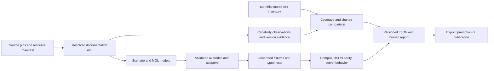

# MongoDB operator audits: evaluation and implementation plan

Status: proposed design; implementation is not part of this change.

Evaluated on 2026-11-15 against Morphia commit `1ff98e9eebbf9bf81680d3cd4c85f33167ba20c6`.
The upstream examples below were checked at MongoDB docs commit
`a5d960b9574cdf31db571249dd6e298ff5b3f104`, rather than assuming the current
documentation layout matches the layout the audit was written for.

## Objective and boundaries

Make operator monitoring reproducible, automatic, and trustworthy: detect new operators,
new contexts and options on existing operators, version changes, missing Morphia support,
and gaps in executable examples. Regeneration must preserve existing curated behavior,
produce reviewable changes, and diagnose documentation changes instead of silently losing
coverage. A successful run must mean that every discovered capability and example has an
explicit, evidence-backed disposition.

Keep Kotlin/JVM coordination and the useful existing Morphia test assertions. Replace the
line-oriented extraction and implicit filesystem state with a versioned data pipeline.
Prefer an adapter to MongoDB's own documentation parser over building another general RST
implementation. Introducing a new operator API or deciding a disputed expected result still
requires engineering judgment; neither should be disguised as a generated passing test.

This design concerns the MongoDB documentation/operator audits. The old binary API history
audit is evaluated below but remains a separate concern. It must not be confused with the
existing Revapi `code-audits` checks, nor expanded into a second SemVer checker here.
Internal design documentation belongs in `design/`; product documentation changes, if
subsequently needed, belong in the separate morphia-docs repository.

## Current implementation and evidence

### Data flow and reviewed surface

The root `audits` profile adds the audits module and skips tests in the other modules. The
audits module re-enables its tests. Its Maven lifecycle clones or pulls `mongodb/docs` into
`audits/target/mongodb-docs` during `generate-resources`, using the moving default branch.

`AggregationAuditTest` and `QueryAuditTest` call `RstAuditor.audit()`, which scans Morphia
Javadoc tags, walks the docs operator directory, extracts and writes examples, considers
GitHub issue creation, checks release tags, modifies core Java tests, and writes AsciiDoc
under this repository's old `docs/` tree. Its `Results` mixes coverage and mutation results.
The live-HTML `OperationAuditTest` is another, partly disabled discovery path.

Reviewed files and downstream contracts:

| Area | Files and relevant behavior |
| --- | --- |
| Acquisition and invocation | [audits/pom.xml](../audits/pom.xml), root [pom.xml](../pom.xml), [.github/workflows/audits.yml](../.github/workflows/audits.yml), and its referenced reusable `evanchooly/workflows` build workflow. The workflow is manual-only and delegates to moving `master`; ordinary PR code audits are a different workflow. |
| Coordination and discovery | [RstAuditor.kt](../audits/src/main/kotlin/dev/morphia/audits/RstAuditor.kt), [OperationAudit.kt](../audits/src/main/kotlin/dev/morphia/audits/OperationAudit.kt), [GithubProject.kt](../audits/src/main/kotlin/dev/morphia/audits/GithubProject.kt). |
| Document and example parsing | [RstDocument.kt](../audits/src/main/kotlin/dev/morphia/audits/rst/RstDocument.kt), [Separator.kt](../audits/src/main/kotlin/dev/morphia/audits/rst/Separator.kt), [CodeBlock.kt](../audits/src/main/kotlin/dev/morphia/audits/model/CodeBlock.kt), [OperatorExample.kt](../audits/src/main/kotlin/dev/morphia/audits/rst/OperatorExample.kt). |
| Model and result semantics | [Operator.kt](../audits/src/main/kotlin/dev/morphia/audits/model/Operator.kt), [OperatorType.kt](../audits/src/main/kotlin/dev/morphia/audits/model/OperatorType.kt), [Results.kt](../audits/src/main/kotlin/dev/morphia/audits/model/Results.kt). |
| Existing audit tests | All five test classes in [audits/src/test/kotlin/dev/morphia/audits](../audits/src/test/kotlin/dev/morphia/audits) and [ExampleValidator.kt](../audits/src/test/kotlin/dev/morphia/audits/rst/ExampleValidator.kt). |
| Consumer and curated material | [TemplatedTestBase.java](../core/src/test/java/dev/morphia/test/TemplatedTestBase.java), [TestCoverageExtension.java](../core/src/test/java/dev/morphia/test/TestCoverageExtension.java), [ActionTestOptions.java](../core/src/test/java/dev/morphia/test/util/ActionTestOptions.java), generated-style tests such as [TestUnset.java](../core/src/test/java/dev/morphia/test/query/updates/TestUnset.java), and the complete lock/ignored-file inventory. |
| Adjacent legacy API audit | [SinceAudit.kt](../audits/src/main/kotlin/dev/morphia/audits/SinceAudit.kt), [MorphiaElement.kt](../audits/src/main/kotlin/dev/morphia/audits/model/MorphiaElement.kt), and `audit-classes.txt`. The enum models Morphia artifacts, not MongoDB server introductions. |
| Other resources | `aggregation.properties` contains an old `$group` mapping; `aggregation-expressions.properties` and `query.properties` are empty. No code in the audit module reads these property files. [audits/README.md](../audits/README.md) does not document a reproducible operational contract. |

### Findings that should drive the implementation

| Finding | Evidence and consequence |
| --- | --- |
| The module currently fails compilation | An isolated Maven compile with both docs-fetch profiles disabled fails at Kotlin API version `1.8`, unsupported by the inherited compiler. Compiling the same main sources to a temporary directory with API `1.9` succeeds, with a warning that `1.9` is itself deprecated. Choose a supported project-aligned setting, rather than pinning another already deprecated version. |
| Source layout assumptions have already changed | `RstAuditor.operatorRoot` assumes checkout-root `source/reference/operator/...`. The sampled monorepo stores the manual at `content/manual/manual/source`, with separate `upcoming` and versioned property directories. Fetching more files will not correct the hard-coded root. |
| Acquisition is not repeatable | Clone/pull occurs as a build side effect, without an immutable docs revision, resolved resource manifest, or last-good snapshot. `mainRoot` is relative to the working directory, unlike the git-root-based paths elsewhere. Different invocation locations can scan different trees or none. |
| Comparison is not a support model | `Operator.implemented` means `resourceFolder.exists()`, not that a Morphia factory, overload, or encoding exists. Extraction creates example directories before `updateGH` checks this field, so generation can make an unsupported operator look implemented. `testCaseExists` only proves a Java file exists. |
| Some missing coverage can disappear | `noExamples` selects examples whose output directory was just created; it does not list operators for which parsing yielded zero examples. Those operators are also excluded from `noTest`. `Results.created` reflects issue creation, and local GitHub dry runs return an empty list regardless of missing support. |
| Classification and identity are lossy | All aggregation files become stage or expression based on a raw `.. pipeline:: $` substring; accumulator and window contexts are not separate. `substringBefore("-")` collapses file variants into one operator/resource path, such as accumulator versus stage forms of `$count`. All files in the directory are candidates, not just operator definitions. `OperationAudit.findMethods` ignores class-level tags and only uses the first matching tag on each method. |
| Document structure is approximated | `RstDocument.read` requires an exact `Example`/`Examples` heading. `Separator` hard-codes underline characters and overwrites repeated heading keys. Parsing partitions the full tail rather than the selected Examples section. Tab handling shares surrounding text by concatenation, with fragile indentation and empty-list assumptions. Filtering and then renumbering examples changes `exampleN` identities. |
| Includes and current example sources are incomplete | Include expansion is one pass, with no dependency graph, cycle detection, include-range handling, or origin spans. YAML fallback scans files by substring. `CodeBlock` does not resolve `literalinclude`, `sharedinclude`, or external `input`/`output` targets, and recognizes only exact argument-free input/output directives. |
| Example semantics are guessed | Code blocks are classified by a few shell-call substrings. Only one action, expected block, and index survive. Setup is inherited from the first prior example with data rather than an explicit scenario dependency. Helpers, projections, cursor options, multiple collections, intermediate actions, and error examples are not represented. |
| Sanitization changes meaning | `substringBefore("//")` damages URL/string content; whitespace normalization changes strings; brace counts ignore strings and regexes. Actions strip `NumberDecimal` wrappers, and replacements silently rewrite `$substr` to `$substrBytes`. These are semantic changes, not formatting. |
| Locks conceal drift rather than resolve it | Only the exact `lock` filename is recognized; `IGNORE_LOCKS` bypasses every lock when the property is present. There is no source fingerprint, structured patch, expiry condition, or drift report. Writers update files in place, and a removed source block can leave stale generated files behind. |
| Generated tests are not executable support evidence | The generator emits unfinished pipelines or empty filters and routes updates through the query template. Both creation and `updateTestAnnotation` add a nonexistent `testName` attribute to JUnit Jupiter `@Test`, producing uncompilable Java in new and existing curated files; `@DisplayName` is the actual label contract. It rewrites existing Java files through Roaster even when their bodies were curated. A source-file existence check cannot distinguish these stubs from real tests. |
| Version checks do not validate versions | `Operator.versionAdded` uses the first `versionadded` anywhere in a file. `hasReleaseTag` returns from inside inline `all`, so it only examines the first method; it checks presence, not the release value. Missing methods do not produce the expected per-method release diagnostic. Option/usage introductions can be mistaken for operator introductions. |
| Test coverage is too coupled to live mutation | Main audit tests invoke the mutating audit. Debug tests depend on a live checkout and write extracted output. `ExampleValidator.data` checks nullability of a non-null list rather than its contents, and the helper is unused. `SinceAuditTest.deprecations` lacks `@Test`. There is no self-contained parser regression corpus. |
| Existing comparisons are too permissive | `TemplatedTestBase.runPipeline` passes `false` to JSONAssert-based list comparison, permitting reordered arrays and extra fields; `orderMatters(false)` affects expected-result comparison through the same broad leniency. `TestBase.toJson` uses relaxed JSON settings, losing strict BSON numeric-type distinctions. These helpers cannot establish the stronger semantic-equivalence contract proposed below. |
| Useful runner infrastructure has brittle inputs | `TemplatedTestBase` discovers fixtures from stack traces, names, and ordinals; its document splitter counts braces without string awareness. Skip flags remove behavioral or serialization coverage. `TestCoverageExtension` returns early when no example methods exist, so it is not an independent completeness check. |
| Reporting and side effects are intertwined | GitHub behavior depends on ambient `GITHUB_ACTION`; “dry run” restricts GitHub writes, not filesystem writes. Issue deduplication is by open title/labels, with no persistent capability key. The separate HTML scanner searches broad `$` code spans, both query/update tests use the expressions catalog URL, and issue creation/assertions are commented out in that path. |
| Legacy output and API history need disposition | `emitDocs` targets an obsolete in-repo AsciiDoc location. `SinceAudit` has hard-coded old Morphia snapshot versions, hand-written migration exceptions, and direct jar downloads; it is not a foundation for MongoDB version tracking. Keep it isolated and decide separately whether to retire it in favor of current API auditing. |

The clean worktree corpus contains **555 `example*` directories, 235 exact `lock` files, 17
operator-level `ignored` files, and one `lockd` file** under core's operator test resources.
The 555 directories comprise 410 aggregation and 145 query examples, not a claim that all
are runnable or generated. The main working checkout had 144 additional empty historical
directories; its count of 699 is not the versioned baseline. All 235 exact lock files
contain a reason. The locks divide into 122
expression, 54 stage, 41 filter, and 18 update examples. Repeated reasons include incorrect
parser-derived names, pipeline ordering, numeric conversion, regex representation, and
inlining JavaScript variables. The exclusions mix non-operators, deprecated aliases,
product constraints, unsupported features, and examples tested elsewhere; these need
different dispositions, not one generic ignore flag.

Reproduce counts from the dedicated clean worktree, with this script; also use `git ls-files`
to distinguish tracked marker contents from local leftovers during implementation:

```python
from pathlib import Path
root = Path("core/src/test/resources/dev/morphia/test")
print(sum(p.is_dir() for p in root.rglob("example*")))  # 555
print(len(list(root.rglob("lock"))))                  # 235
print(len(list(root.rglob("ignored"))))               # 17
print([str(p) for p in root.rglob("lock*") if p.name != "lock"])
```

File-level baseline: 555 `name`, 553 `action.json`, 525 `expected.json`, 521 `data.json`,
20 `data1.json`, 15 `data2.json`, 4 `data3.json`, and 21 `index.json` files. The
`tsIncrement/example2` and `tsSecond/example2` directories contain only a name and lock;
they must be explicitly classified rather than vanishing from coverage denominators.
The current display-label corpus contains 110 generic `main` labels, so migration cannot
blindly turn existing `name` values into meaningful identifiers without recovering context.

Representative evidence:

- [geoNear/example3/lockd](../core/src/test/resources/dev/morphia/test/aggregation/stages/geoNear/example3/lockd)
  requests curated changes but is not recognized by the current lock check.
- [lookup/example1/lock](../core/src/test/resources/dev/morphia/test/aggregation/stages/lookup/example1/lock)
  includes pipeline reordering; [regex/example1/lock](../core/src/test/resources/dev/morphia/test/query/filters/regex/example1/lock)
  notes mixed expected examples. These require scenario/semantic handling, not just a wider regex.
- Isolated probes of the actual `CodeBlock` implementation truncated `"https://example.invalid/a"`
  to `"https:`, changed `"two  spaces"` to `"two spaces"`, removed a `NumberDecimal("0.10")`
  wrapper, threw `NoSuchElementException` for a terminal empty code directive, and extracted
  zero blocks from an io directive with external input/output paths. The probes compiled
  unchanged audit sources outside the worktree with an API-version override; they did not
  run the mutating audit tests or change core fixtures.

### Current upstream counterexamples

These are source observations, not assumptions about every historical manual:

- The [pinned manual project](https://github.com/mongodb/docs/tree/a5d960b9574cdf31db571249dd6e298ff5b3f104/content/manual/manual)
  has its own `snooty.toml`. Its configuration includes a remote shared-include root.
- [$median's accumulator page](https://github.com/mongodb/docs/blob/a5d960b9574cdf31db571249dd6e298ff5b3f104/content/manual/manual/source/reference/operator/aggregation/median.txt)
  declares version 7.0 under its group definition and refers to separate expression/window
  contexts. Its example uses external `input` and `output` file paths, not inline shell text.
  The `source/code-examples/tested` path is a repository symlink to
  `../../../../code-examples/tested`. The input exists under
  [content/code-examples/tested](https://github.com/mongodb/docs/blob/a5d960b9574cdf31db571249dd6e298ff5b3f104/content/code-examples/tested/command-line/mongosh/aggregation/accumulators/median/median-rating-by-year.js).
  A naive API lookup through the symlink returned 404; sparse acquisition must include its
  target. MongoDB also maintains a [mongosh example test corpus](https://github.com/mongodb/docs/tree/a5d960b9574cdf31db571249dd6e298ff5b3f104/code-example-tests/command-line/mongosh).
  Prefer these tested snippets and their setup/expectations when available, while still
  accounting for remote shared includes and genuinely missing/generated assets explicitly.
- [$lookup](https://github.com/mongodb/docs/blob/a5d960b9574cdf31db571249dd6e298ff5b3f104/content/manual/manual/source/reference/operator/aggregation/lookup.txt)
  contains a 5.0 introduction for concise correlated-subquery syntax inside an existing
  operator page. It also contains SQL and driver-specific examples. Taking the first
  version directive as the operator's introduction or merging all language tabs is wrong.
- [$setWindowFields](https://github.com/mongodb/docs/blob/a5d960b9574cdf31db571249dd6e298ff5b3f104/content/manual/manual/source/reference/operator/aggregation/setWindowFields.txt)
  has both a 5.0 operator introduction and a later 8.3 feature introduction.
- MongoDB's [Snooty architecture](https://github.com/mongodb/snooty-parser/blob/0c26866083a02177a52ade1ccb17cc61a2816be7/HACKING.md)
  describes RST/YAML parsing into a JSON AST and project configuration. This makes a
  pinned adapter promising, but does not establish a stable public AST API or that all
  remote/build-generated example dependencies can be resolved offline. Verify both in phase 2.

## Proposed system

### Separate stages and ownership



Each stage takes explicit inputs and produces immutable outputs plus diagnostics. No
parsing or comparison API writes into `core/src`, edits product docs, or calls GitHub.
Default output is `audits/target/`; default execution is offline against pinned inputs.
Live acquisition, promotion, and publication are separate commands. A failed candidate
never replaces the accepted snapshot, registry, fixtures, or tests.

Proposed repository contract:

| Location | Ownership |
| --- | --- |
| `audits/config/source-pins.yaml` | Docs repository/revision, manual property roots and release labels, parser version/digest, allowed dependent resource sources. Human-reviewed or updated by a dedicated automation PR. |
| `audits/catalog/` | Versioned, normalized accepted capability observations, provenance, and schema. Includes the baseline needed for offline comparison; large raw caches belong in retained artifacts/content-addressed storage. |
| `audits/fixtures/` | Small, redistributable pinned RST/YAML/example dependency fixtures and expected parser outputs, including historical layouts and known failures. Preserve source attribution/licensing. |
| `audits/overrides/` | Structured, validated corrections and exemptions; copied curated snapshots where extraction cannot yet reproduce existing behavior. |
| `audits/adapters/` | Explicit Morphia factory/argument bindings and complex example adapters. Reuse source tags for ordinary inventory; avoid maintaining an unnecessary second API registry. |
| `audits/target/<run>/` | Raw/parsed candidate artifacts, generated code/resources, diagnostics, comparisons, and proposed changes. Never an implicit input to the next run. |
| Core test inputs | Accepted fixtures and generated Java are committed under dedicated generated namespaces inside core's existing test source/resource roots. Handwritten adapters remain separately owned. Ordinary core builds consume these accepted files and never run the audits generator. |

Define one explicit repository root and pass all other paths. Inputs record schema and
normalizer versions; outputs sort by stable identity, use UTF-8 and deterministic serialization,
and exclude clock-dependent fields from reproducibility hashes. Observation timestamps are
report metadata. A repeat run with identical inputs must be byte-identical.

### Source acquisition and document parsing

1. Discover candidate docs revisions in the scheduled job, then resolve each to a full
   commit before extraction. Use a sparse/filtered checkout where practical, but include
   the selected property configuration and complete example dependency closure, following
   repository symlinks such as `source/code-examples/tested` to their pinned targets. Ordinary
   Maven compile/test must not clone or pull a moving repository.
2. Configure property roots explicitly. Support the legacy single-project tree and the
   current monorepo as adapters. Watch selected supported-version properties plus
   current/upcoming; labels are source metadata, not inferred from a directory name alone.
3. Prototype a pinned Snooty helper, invoked by the Kotlin coordinator and returning a
   versioned Morphia-owned JSON interchange format. Retain source locations and include
   origins before postprocessing obscures them. Keep parser-specific node types behind
   this boundary; do not couple all Kotlin models to an upstream AST implementation.
4. Resolve RST, nested includes, Giza YAML, substitutions, literal includes, tabs/composables,
   io directives, and include ranges using upstream semantics. Select mongosh examples
   explicitly, while retaining the existence and identity of other language examples.
   Diagnostic output must identify unresolved paths and the complete include chain.
5. Resolve shared/generated example dependencies in the acquisition stage. Record their
   immutable origin/digest and fetch policy. Parsing and tests operate offline, with bounded
   resource resolution and cycle detection. Missing assets produce `unresolved-source`,
   never “no examples.” Do not require credentials or a live upstream AST database.
6. Enumerate capabilities from definition roles and MQL catalogs, then cross-check them.
   Unknown directives, unmatched index entries, contradictory definitions, lost categories,
   or a large count drop invalidate the affected candidate. An intentionally empty category
   requires declared evidence; zero is not automatically a successful audit.

Phase 2 must demonstrate the pinned median/lookup/setWindowFields cases and representative
old include/tab patterns without ambient network access. If Snooty cannot provide a stable
usable boundary, compare a maintained narrow adapter over its parsing layer with a limited
RST parser for a declared subset. Require identical fixture contracts and explicit unsupported
diagnostics. Do not expand the existing heuristics into an undocumented fallback that drops
features. Record the decision and dependency update procedure in this design.

### Capability identity, Morphia coverage, and version evidence

Use a key consisting of server product, operator token, and execution context. Contexts
include query predicate, query projection, update operator, update modifier, pipeline stage,
aggregation expression, group accumulator, and window function. Track aliases and
equivalences explicitly; two spellings or contexts can share an implementation without
losing their separate documentation evidence. Treat options, syntax forms, and context
availability as capability facets with their own lifecycle.

Example of the logical model, not a claim that the schema has been implemented:

```yaml
key: mongodb-server/group-accumulator/$median
token: $median
context: group-accumulator
lifecycle:
  introduced:
    version: "7.0"
    confidence: explicit
    evidence: [median-definition-versionadded]
  deprecated: null
observations:
  - sourceRevision: a5d960b9574cdf31db571249dd6e298ff5b3f104
    property: manual
    definition: reference/operator/aggregation/median.txt
    evidence: median-definition-versionadded
support:
  inventoryStatus: pending-comparison
```

In the actual schema, evidence IDs resolve to immutable source revision, resource path,
definition/section anchor, source span, raw text digest, and parser/normalizer versions.
Preserve independent lifecycle events, rather than a single nullable string per page.
Store all of the following separately:

- MongoDB operator/context introduction; feature or option introduction; changed behavior;
  deprecation/removal; edition/service, topology, FCV, and Stable API constraints where known.
- First/last observation in the tracked docs. First observed is not first released.
- Morphia implementation version (`@since`), server requirements (`@mongodb.server.release`),
  and actual test runtime requirements. These answer different questions.

Attach a version directive to the enclosing operator definition or named feature. Parse
versions structurally, including ranges and qualified releases. Missing or contradictory
evidence stays `unknown`/`conflicting`; do not manufacture a minimum version from the first
file occurrence or the oldest retained snapshot. Historical backfill uses pinned older
manuals and official release notes, with an evidence ledger for reviewed corrections.
Disappearance from one source revision is a suspected documentation change until other
evidence establishes removal. Preserve history when pages move or split.

Build the Morphia inventory from source declarations and Javadoc metadata, retaining fully
qualified signatures, overloads, factory classes, builder methods, visibility, return types,
and both class-level and method-level tags. Aggregate class tags with method tags without
duplicating identities or treating every untagged helper as unsupported. Add explicit
bindings only where shared builders, aliases, dynamic operators, or generic passthrough
prevent unambiguous inference. Distinguish typed API support from raw BSON passthrough.

Compare per capability/facet and all relevant overloads. Report at least: missing typed API,
partial support, unsupported by policy, version annotation missing/wrong/ambiguous, missing
serialization coverage, missing behavior coverage, unresolved docs extraction, and unknown
mapping. A resource directory, Java test file, or generated raw-document test proves none
of the other statuses. A failed or empty API inventory invalidates comparison.

### Example and MQL models

Keep raw source blocks unchanged. Parse selected shell snippets into a restricted JavaScript
syntax tree and lower recognized constructs into typed BSON and operation models. Select a
maintained parser through a small compatibility spike; a JVM dependency or isolated helper
is acceptable, but textual replacements and brace counting are not the normalization layer.

The model must represent setup statements in order, collection/database names, variables
with explicit dependencies, multiple insert batches, multiple indexes and their options,
queries plus projection/sort/limit/options, pipelines, update filters/documents/options,
intermediate steps, expected results/errors, and side effects. Preserve BSON numeric types,
dates, timestamps, ObjectIds, regex flags, binary values, null/missing distinctions, and array
and pipeline order. Object-key order may be ignored only where semantically irrelevant;
sort specifications, compound index keys, and order-sensitive embedded-document equality
need explicit treatment. Never reorder a pipeline or array merely to make a comparison pass.

Introduce a BSON-tree comparator before migrating repairs. It compares BSON types and
values directly, rejects unexpected fields, preserves ordered operations and nested arrays,
and uses path-specific policies for document-key order and numeric tolerances. An unordered
result policy applies only to the top-level result multiset and preserves duplicate counts;
it does not relax nested arrays or permit extra fields. Add negative tests for reordered
stages, extra fields, changed numeric types, changed sort-key order, and duplicate loss.
Run old and new comparisons side by side, record newly exposed failures, and classify each
as an intended compatibility policy, a faulty expectation, or a Morphia defect. Do not
silently bless a mismatch with the old JSONAssert result. Step 4 equivalence requires this
comparator; the old helpers are not its oracle.

Use a documented allowlist of BSON constructors and safely evaluable constants. Variable
inlining is an AST transformation with recorded provenance. Unknown functions, computed
setup, destructive commands, malformed syntax, or unbounded behavior become explicit
unsupported cases. Do not execute arbitrary documentation JavaScript to discover its meaning.
Actual operations execute only as planned against disposable test databases, with timeouts,
controlled collections/topology, and capability-specific requirements.

### Descriptive example names and backporting existing tests

Test methods and data directories must use legal identifiers synthesized from the example's
name in the documentation, replacing `example1`, `example2`, and similar ordinal names in
both new generation and the existing corpus. For example, the illustrative heading
“Calculate Median Ratings by Year” becomes `testCalculateMedianRatingsByYear` and the
directory `calculateMedianRatingsByYear`. Operator-level class names can remain `TestMedian`
or an equivalent generated class name; the individual test and fixture name carry the
example's meaning.

Use one shared naming function for the generator and migration tool:

First group the language tabs belonging to one documented scenario and elect the supported
mongosh variant as its executable reference. Other equivalent language variants retain their
source observations and point to that scenario's canonical descriptive name; they do not
create competing test methods or data folders. Grouping requires shared scenario evidence,
and differing operations or requirements must not be merged just because the titles match.
If genuinely distinct variants are supported later, assign separate, meaningful qualified
scenario names before emission. Collision checks apply to the resulting emitted scenarios,
plus all physical legacy/generated neighbors. Test both equivalent two-language tabs and
same-title tabs with different semantics.

1. Read the AST's plain-text example heading/name, removing RST presentation markup while
   retaining operator words, numbers, and meaningful context. Normalize Unicode and word
   boundaries deterministically, use `Locale.ROOT`, and produce an ASCII lowerCamelCase
   stem. Specify deterministic escaping for characters without a usable ASCII decomposition;
   do not depend on the machine locale or filesystem's Unicode behavior.
2. Require the shared bare stem itself to be a legal Java identifier as well as a portable
   folder name, even though a `test`-prefixed method could accept more inputs. Use the
   fixed `case` prefix plus capitalized original stem when needed: `switch` becomes
   `caseSwitch`, and `2dSphere` becomes `case2dSphere`. Fully lowercase the first word,
   including acronyms (`ISO Week` becomes `isoWeek`). Cap the stem at 80 ASCII characters
   and validate the full target path budget; long headings require a meaningful bounded
   abbreviation through the same naming map and collision checks, never silent truncation.
   Derive the method as `"test" + capitalizeFirst(stem)` without a second acronym/case
   conversion: `isoWeek` must produce `testIsoWeek`. Test the exact round trip through
   today's `discoverResourceName` during backporting. Keep raw source title and `@DisplayName`
   separately, including the existing `name` file contract during compatibility migration.
3. Check uniqueness across each physical destination resource directory and Java class,
   including all contexts/language variants sharing that destination and pre-existing
   legacy folders. Compare folder names after normalization and case-folding. Also reserve
   every declared or inherited method name in the target Java class, including handwritten
   neighbors and helpers such as `testQuery`/`testPipeline`. Exclude only the same case's
   existing binding when preserving its name. Disambiguate
   duplicate headings or normalization collisions with meaningful ancestor-section/tab
   qualifiers or a stable upstream anchor/snippet name. Never append an encounter-order
   counter. If meaningful automatic disambiguation is still impossible, require an explicit
   canonical-name entry and fail the candidate instead of overwriting another example.
4. Generic/missing headings such as `main`, `Examples`, or ordinal-only `Example 1` need a descriptive name recovered from the
   documentation's enclosing section, named snippet, or scenario metadata. Preserve the
   evidence for that choice; ambiguous matches require a reviewed naming entry, not an
   ordinal fallback or a name invented solely from the current document position.

Persist the mapping from source anchor/scenario/language to the assigned descriptive name.
Names are not regenerated from scratch after every upstream edit. A reordered example,
inserted sibling, or cosmetic heading change must keep its established method/folder name;
record the current display title separately. A genuine rename or split/merge is an explicit
mapping change with previous-name aliases and references updated together. Source text and
normalized content have separate digests; neither a content change nor the physical line
number is the example's identity. Qualified descriptive names, rather than opaque directory
IDs, are the keys used in manifests, overrides, test descriptors, and coverage reports.

Reconciliation has an explicit match order within the same capability/context/language:
first a persisted explicit source label or referenced snippet identity; then a unique
auto-anchor plus enclosing context; then a unique normalized scenario/dependency fingerprint.
An auto-anchor alone is not durable because it may be derived from a changed heading.
Fingerprints are matching evidence, never directory names or the canonical identity. If
content also changed, structural operation/dependency similarity can propose candidate
matches with a recorded score and explanation, but an uncertain or non-unique match requires
a reviewed mapping. Never choose the closest case merely because its ordinal stayed the
same. A genuinely new scenario can get a new synthesized name only after reconciliation
accounts for existing cases; unresolved disappearances or competing matches stay pending
rather than orphaning old names. Test a cosmetic title edit and inserted sibling in the
same revision, as well as moves, edits, splits and duplicate headings.

Backport this convention before broad fixture regeneration. Import every existing method,
resource directory, `name` file, `@DisplayName`, lock, manual body, and `ActionTestOptions`
into a legacy-to-descriptive-name manifest. The naming backport stays in the existing
packages/operator directories, changing the example directory segment and method name
together; moving to a generated namespace is a separate later cutover. Match to pinned docs context without rerunning
the old destructive extraction path; use existing corrected labels as evidence, and repair
generic/wrong parser labels through the naming map. Produce a dry-run rename patch that
renames Java methods and directories together and updates Javadocs, hard-coded resource
references, auxiliary-data paths, and coverage discovery. Preserve handwritten bodies,
assertions, annotations/options, and fixture bytes. A one-time migration may use targeted
Java AST/text-span edits; routine generation must still never rewrite a curated class.

Update `TestCoverageExtension` before those renames: its current `testExample*` prefix scan
would otherwise stop checking the renamed tests. Use descriptor/manifest membership for
completeness, supporting explicit legacy aliases only during transition. Do not infer that
zero matching methods means success. Each accepted example has exactly one canonical test
binding and fixture location; aliases are redirects, not duplicate owned copies.
Any surviving legacy parser/report adapter must resolve folders and methods through the
naming map before this backport. In particular, retire or redirect the ordinal construction
in `OperatorExample.folder`, `Operator.output`, and `RstAuditor.addTestCases`; leaving that
until final cleanup would make named examples appear missing. The mutating legacy entry
points remain disabled, and a contract test prevents ordinal path reconstruction after cutover.

Migration acceptance: all in-scope legacy examples have unique descriptive names or an
explicit unresolved disposition in the candidate report. An unresolved name blocks that
case's promotion, never disables its existing test, and cannot count as a completed backport.
Every renamed test still loads the same data; old and new
names map one-to-one where semantics are unchanged; there are no orphan directories,
collisions, lost locks, or lost assertions. Run the affected operator tests with Critter
first and reflection. Naming tests must cover punctuation/RST roles, leading numbers,
keywords, Unicode, duplicate titles, case-insensitive filesystem collisions, reordered
sections, inserted examples, and cosmetic title edits. No active `exampleN` naming remains
when the backport is complete; historical aliases may remain in the migration ledger.

### Replace lock markers with validated corrections

Keep all current locks and curated files intact until their replacements pass equivalence
checks. Import each exact lock, `lockd`, ignored marker, and affected Java method into a
migration manifest with a reason, imported display title, and a known legacy-to-descriptive
identity mapping. Inventory the Java method's
`ActionTestOptions` and overrides too: `orderMatters`, `removeIds`, `skipDataCheck`,
`skipActionCheck`, minimum server/driver versions, index handling, and find/update options.
Count distinct examples and actually executed assertion paths, not method-call occurrences,
to establish serialization/behavior coverage denominators. A lock does not encode which
files were edited: preserve the entire existing example snapshot first.

An override records example/capability ID, reason/category, source dependency digests,
preconditions, typed changes or a curated artifact/Java adapter, and a review condition.
Apply it after extraction and before generated outputs are validated. Prefer small semantic
changes: expected-label correction, explicit setup variable binding, typed number/regex
conversion, fixed expected result, or declared collection mapping. If the new parser handles
the case natively, prove equivalence and remove the override.

On an upstream change, re-evaluate preconditions. A stale correction must fail validation and
produce a diff, not apply loosely to a new example or freeze the old example without notice.
For cases without recoverable historical source, preserve the current curated baseline and
mark the upstream match as unknown until reviewed; do not claim an exact source fingerprint.
Exemptions are scoped dispositions such as non-operator, policy exclusion, tested elsewhere,
unsupported syntax, or environment unavailable, with rationale and reevaluation criteria.
The report always includes their counts and changes.

Ownership is at the complete-file level for generated Java and the complete manifest-owned
example-resource directory for data, never an inferred subset of methods inside a curated
class. Treat every existing mixed `TestX.java` as handwritten for routine regeneration;
only the explicit one-time naming migration or a reviewed later cutover may edit it.
Generated cases use separate classes containing only generated methods with descriptive
names. Old and replacement cases may coexist only inside isolated candidate validation,
with the duplicate relationship declared; the accepted registry must reject two active
test bindings or fixture owners for one qualified example name. Before any namespace move,
descriptor loading and manifest-based completeness checks must be in place. Cutover adds
the replacement and retires its old active binding/resources in the same reviewed change,
including reference checks. Do not delete a mixed class while it still owns other examples.

### Generate useful tests without erasing handwritten work

Produce data and tests from the scenario model, using the same qualified descriptive name
for both methods and fixture directories.
Replace name/stack-trace lookup with explicit example descriptors; a compatibility adapter
can map existing `exampleN` methods to descriptors during migration.

New generated tests use a core-owned `OperatorCaseRunner` and a descriptor containing an
absolute classpath resource path such as
`/dev/morphia/test/generated/fixtures/<context>/<operator>/<exampleName>/scenario.json`;
they do not inherit the old package-relative `prefix()/exampleN` lookup contract. The
descriptor binds the qualified descriptive name, fixture path, context, requirements,
comparison policy, and an optional handwritten
DSL adapter. Generated Java can group cases by operator/context, but its entire file remains
generator-owned. Legacy `TemplatedTestBase` classes keep their current paths until explicitly
migrated, and old/new coverage checks reconcile through the identity map rather than method
names. This descriptor/ownership contract is required before the first step 4 promotion.

For supported translations, generate actual Morphia DSL code through validated factory and
argument bindings, including query versus update versus pipeline dispatch, builder chains,
named options, index setup, multiple collections, and version requirements. Emit real
JUnit `@Test`/`@DisplayName` metadata. A generator contract test must compile representative
outputs against the current Morphia API. Missing bindings produce an explicit gap and a
proposed adapter task; never place empty tests, `TODO` bodies, or disabled placeholders on
the passing-coverage path.

Preserve handwritten Java bodies. Fully generated classes and resources live in dedicated
manifest-owned namespaces within core's committed test roots; custom DSL adapters remain
separately source-owned. Maintain a generated-artifact manifest so promotion can remove stale generated files
without touching curated artifacts. Promotion validates all outputs first, computes a diff
against the accepted state, and applies the complete change atomically or leaves it untouched.
Running generation twice must not reformat or rewrite unrelated source files.

A candidate records the exact base core revision, accepted-artifact manifest digest, hashes
of every protected/affected file, source pins, and generator/schema/adapter versions. The
integration attestation binds these inputs to the tested candidate digest and mapper/server
matrix. Before promotion, compare the target checkout and manifest to that base and verify
affected files still match, including uncommitted edits. If anything relevant has moved,
reject promotion: rebase/regenerate the candidate and rerun its affected compile/parity
checks. Do not reuse a passing result against a different API, adapter, manifest, or target
tree. Promotion is a compare-and-apply operation, with rollback or no changes on failure.

The candidate records its base core commit, accepted-manifest digest, generated artifact
digests, and expected hashes for all touched or protected curated files. Promotion compares
those with the target checkout and refuses stale candidates or locally modified target
files. Rebase/regenerate and rerun the relevant compile/parity gates before retrying; a
successful test against an older core revision is not promotion approval for a newer one.
Delete stale files only when the previous manifest owns them and their current hashes still
match the accepted generated state. Unknown or manually edited files are conflicts, not
permission to overwrite. Apply the validated change set as one operation with rollback on
failure; no partial generation becomes the new accepted baseline.

Separate three kinds of evidence:

1. **Serialization parity:** independently parsed reference operation BSON versus the BSON
   emitted by the Morphia DSL. A raw `Document` passed through unchanged is reference-only,
   not proof of typed operator support.
2. **Behavioral parity:** reference driver operation and Morphia operation run against
   separate, identically seeded collections/databases. Compare results, errors, and write
   side effects, including updates and `$out`/`$merge`, using declared order/type policies.
3. **Published expectations:** where upstream provides meaningful expected output, validate
   both executions against it. Do not regenerate expected output from the implementation
   under test. For nondeterministic, approximate, or time-dependent operators use justified
   invariant/tolerance checks, not a captured random golden result.

The existing `TemplatedTestBase` setup/execution infrastructure is a useful migration asset.
Replace its permissive JSON comparison with the explicit BSON comparator for migrated cases
and add descriptors rather than rewriting every test at once. Any skip of
serialization or behavior is a reportable coverage status with a reason, not “full coverage.”

Build and dependency ownership is explicit:

- `audits` owns pure extraction, inventory, normalization, emission, golden-output tests,
  and report schemas. It can read core source declarations without depending on core's
  compiled classes or test helpers. Its normal unit tests remain offline.
- `core` owns generated-test compilation and execution, the reusable parity helpers, and
  custom Java adapters. Fully generated accepted files are **committed outputs**, not
  files regenerated during ordinary Maven builds. Promotion updates only their manifest-
  owned namespace under `core/src/test/java` and `core/src/test/resources`.
- A separate candidate-integration command consumes the emitted candidate artifact and
  its exact core revision, creates a temporary checkout, and stages the candidate files
  there in place of the matching accepted generated files. It builds core dependencies,
  compiles the candidate suite, and runs selected tests with Critter then reflection using
  core's existing test dependencies and utilities. It never edits the caller's checkout.
  The same command supplies the generator compile gate and pre-promotion parity evidence.
- There is no core-to-audits Maven dependency and no dependency cycle. Audits does not need
  a core test-jar dependency or a second copy of core's test dependency graph. If a later
  shared test-support module is justified, propose that separately. Do not rely on running
  the current `-Daudits` profile to execute core tests: it adds audits to the base reactor
  and sets a parent-level test-skip property. Step 0 must replace that implicit skip/mutation
  behavior with explicit unit versus candidate-integration commands.

Examples using sample databases need a dataset contract as well: versioned dataset identity,
content/provenance, and acquisition requirements. If the original dataset cannot be acquired,
mark behavior validation unavailable. A reviewed minimal substitute is an explicit derived
scenario with its own assertions; it must not pretend to reproduce the original documented
output. Reference expectations come from preserved docs or independently reviewed evidence,
never from writing the current Morphia result back as the expected output.

### Monitoring, reports, and failure behavior

Create an offline PR job for schemas, fixture parsing, model comparison, generator compilation,
and determinism. Use a separate scheduled/manual discovery job for fresh upstream candidates.
The discovery job produces a proposed pin/catalog/fixture change and a categorized report;
it does not overwrite accepted state just because upstream changed. Add capability-selected
server integration jobs, exercising Critter first and reflection for Morphia paths. Use a
configured supported MongoDB/driver matrix and explicit edition/topology/FCV requirements;
unsupported environments are visible skips, not missing operators.

Report full inventory counts and their denominators per context, parse success/failure,
new/changed/missing capabilities, version conflicts, fixture resolution, runnable/reference-
only/manual cases, stale overrides, exemptions, and actual executed/failed/skipped checks.
Always upload machine-readable JSON, a readable summary, provenance, candidate diffs, and
reproducer inputs on both success and failure. A versioned report schema distinguishes
acquisition/parser errors from real Morphia gaps. Retain the last accepted snapshot across
CI cache expiry; a best-effort cache is not the historical record.

Apply completeness gates per artifact and domain. Invalid operator discovery, an empty API
inventory, or unexplained capability collapse blocks that domain's catalog comparison and
implementation-issue publication. Missing example assets, stale example overrides, invalid
scenario models, failed generated compilation, and affected test failures block promotion
of those test artifacts. They must not conceal an independently verified new capability
from a healthy operator inventory: report/publish that finding with example coverage marked
incomplete. Preserve the prior accepted artifacts for any failed domain, expose all partial
results, and never label a partial run a complete replacement. Expected additions and valid
reviewed exclusions remain actionable findings, not parser errors.

GitHub issue creation is a separate opt-in publisher consuming a validated report. Give it
stable keys such as capability/context/facet plus finding type, include immutable evidence,
and track both open and closed dispositions to avoid duplicate/reopened noise. It must have
no effect on whether coverage checks pass. Ordinary tests and report generation require no
GitHub token. Design the future automation's permissions and approval policy explicitly;
do not use ambient CI variables as permission to write. Product-doc reports, if wanted,
are exported for the morphia-docs checkout rather than written into this repo's `docs/` tree.
Freeze the four currently tracked legacy operator `.adoc` tables in `docs/modules/ROOT/pages`
and disable their writer in step 0; do not delete them while the legacy docs module still
consumes them. Retiring or migrating those pages is a separate documentation change,
coordinated with morphia-docs, not a side effect of operator regeneration.

### GitHub transport: replace the Java client with `gh`

**Feasible and recommended.** The current Java client is used only in `GithubProject` and
the legacy `OperationAudit` path. Those calls read repository issues, labels, and milestones
and create an issue with title/body, labels, and a milestone. `gh` exposes all of these;
no current functionality requires keeping `org.kohsuke:github-api`.

| Required interaction | CLI/API route |
| --- | --- |
| Repository identity and metadata | `gh repo view OWNER/REPO --json nameWithOwner,url` or explicit `gh api --method GET repos/OWNER/REPO`. |
| Open and closed issue inventory | `gh api --method GET --paginate --slurp 'repos/OWNER/REPO/issues?state=all&per_page=100'`; filter out entries containing `pull_request`. Do not rely on `gh issue list`'s default limit or an unbounded search assumption. |
| Known issue state/body/labels/milestone | `gh issue view NUMBER --repo OWNER/REPO --json number,title,state,body,labels,milestone,url`, or the corresponding REST issue endpoint. |
| Labels and milestone resolution | Paginated GETs of `repos/OWNER/REPO/labels` and `repos/OWNER/REPO/milestones?state=all`, retaining label names and milestone numbers/state. REST issue payloads use the milestone's `number`, not its global `id`. Missing policy-required labels/milestones are actionable publisher errors, not guessed defaults. |
| Create with all current metadata | `gh issue create --repo OWNER/REPO --title ... --body-file ... --label ... --milestone ...` supports the existing operation. Prefer `gh api --method POST repos/OWNER/REPO/issues --input request.json` in the adapter so its response is JSON including the created issue number. |
| Update an existing finding | `gh issue edit` supports body/title/labels/milestone edits; prefer a REST PATCH through `gh api --input` when structured responses are needed. Change only publisher-owned content/metadata and preserve manual edits. |
| Resolve upstream docs revisions/content | Explicit `gh api` GETs can read commits, refs and contents. Use ordinary `git` for the immutable sparse checkout and offline blob materialization; the GitHub issue publisher does not own docs acquisition. |

The [official API command contract](https://cli.github.com/manual/gh_api) supports structured
input/output and pagination; [issue creation](https://cli.github.com/manual/gh_issue_create)
covers the current write fields. Locally installed `gh 2.92.0` was checked read-only against
MorphiaOrg/morphia: repository metadata, issue JSON including closed issue3234, labels, and
all-state milestones returned the required fields. The REST issues endpoint also returned
a PR, confirming that filtering is necessary. Forced multi-page checks returned all 25
labels over three pages and 98 milestones over two pages. No live create/edit operation was performed;
mutation capabilities were verified from installed CLI help and official command docs.
Write permissions and end-to-end mutation should later be tested only in an explicitly
designated disposable repository.

Implement a small Kotlin `GhGateway` around a fakeable process executor, not shell-script
string interpolation. Use a configured/pinned `gh` executable and a tested version range;
pass argument arrays via `ProcessBuilder`, explicit host and repository, bounded execution
time, and JSON payload files/stdin. Parse stdout as JSON; collect bounded stderr separately,
check exit status, and classify missing binary, authentication/permission errors, invalid
JSON, rate limits and timeouts. Set the child process's host/repository/credential selection
explicitly, overriding unrelated inherited `GH_HOST`/`GH_REPO` and selecting only the
appropriate token environment for that host. Suppress prompts/pagers/update notices.
Do not log tokens or use verbose HTTP tracing in normal runs. Unit tests inject recorded
process results and never need the binary, credentials or GitHub access; report-only mode
must never spawn a mutating command. The generic API command has no application-level
dry-run guarantee, so enforce this separation in the gateway's command policy.

Use REST pagination for completeness, then normalize the response into the existing
publisher's own issue/label/milestone types. Parse slurped output in Kotlin: the tested CLI
does not allow `--slurp` together with its `--jq`/`--template` flags. Set `--method GET` explicitly on reads because
adding `gh api` fields can otherwise change the default method. A ledger and stable body
marker identify each capability/finding across open and closed issues; search results may
help lookup but are not a uniqueness guarantee. Serialize publishers per repository in CI.
On an uncertain create result, reconcile the marker/ledger using a paginated all-state
issues listing ordered by creation and filtered for the exact body marker before any retry;
the issue-create endpoint does not supply the application with a unique-key constraint.
Retry reads with bounded backoff and respect rate-limit responses; do not blindly replay
creates. Partial failures leave a resumable publication journal and do not alter audit
coverage results.

Persist intent to a durable publication journal before issuing the POST, independently of
ephemeral job caches. A timeout or lost response transitions it to `possibly-created`:
killing the local process does not cancel a request already received by GitHub. Poll the
all-state listing for the marker over a bounded reconciliation interval; a single empty
listing proves nothing. If the issue still cannot be found, leave publication unresolved
for a later reconciliation or explicit operator disposition, with no automatic POST replay.
Subsequent runs must recover that state before publishing; missing/expired required journal
state stops publication rather than treating the finding as new. Add a contract case where
the created issue appears only after the first reconciliation read.
An intent without a recorded outcome is also recovered as `possibly-created`, covering a
crash before the caller could record its timeout or result.

Validate returned issue JSON against requested publisher-owned fields, including label
names and the milestone number. A successful process exit or HTTP creation status is not
enough: the [issue API](https://docs.github.com/en/rest/issues/issues#create-an-issue)
documents that metadata can be omitted depending on caller permissions. Record the created
issue number even when metadata validation fails, classify the discrepancy, and repair or
report it through that issue rather than creating another. Include contract cases where
milestone `id` differs from `number` and where a successful response omits requested metadata.

The [CLI environment contract](https://cli.github.com/manual/gh_help_environment) uses
`GH_TOKEN`/`GITHUB_TOKEN`. The current reusable workflow sets `GITHUB_OAUTH`, so replacement
must explicitly map the chosen credential to `GH_TOKEN`; do not assume the old environment
works unchanged. Ordinary offline/report jobs need no write token. A separate opted-in
publisher job uses only the required `issues: write` permission and an explicit target;
private upstream acquisition, if ever required, is a distinct read-credential concern.

After both Java-client paths have been replaced or retired, remove the audits dependency
and, if still unused elsewhere, its parent dependency-management entry. Add contract tests
for multi-page responses, PR filtering, missing label/milestone, closed dispositions,
missing/old CLI, auth failure, malformed JSON, rate limits, timeout-after-create reconciliation,
and preservation of manual issue metadata. This is a transport substitution, not permission
to turn ordinary tests into a publisher.

## Test strategy and acceptance contract

| Layer | Required coverage and assertions |
| --- | --- |
| Acquisition | Immutable refs; both source layouts; incomplete checkout; missing/moved dependencies; offline rerun; content digests; failure leaves the accepted snapshot unchanged. |
| RST/AST adapter | Nested RST/Giza includes and ranges; substitutions; tabs/composables/languages; inline/external io blocks; literal/shared includes; repeated headings; unusual indentation; EOF truncation. Assert content, diagnostics, source spans, and dependency origins. |
| Capability model | Same token in multiple contexts, aliases, non-operators in directories, index/definition disagreement, options added to existing operators, removal ambiguity, and per-version availability. |
| Version evidence | Operator-level versus nested feature `versionadded`, `versionchanged`, multiple overload annotations, wrong release values, absent/contradictory evidence, historical first observation, prerelease/range comparisons, and FCV/product constraints. |
| MQL normalization | URLs and comments inside strings; escaped quotes/braces; regexes; Unicode; exact whitespace; Decimal128/Int32/Int64; dates; variables; helper functions; multiple collections, indexes, actions and expected errors. Round-trip BSON types, not just JSON text. |
| Metamorphic parser checks | RST whitespace, heading style, harmless prose, tab order, and include relocation do not alter normalized scenario meaning or reassign persisted IDs. Changing string whitespace must remain a meaningful change. |
| Names and corrections | Legal descriptive names from docs; deterministic collisions and generic-heading resolution; reorder/insert/title-edit stability; import every legacy marker, display title and per-example option; retain curated bytes; strict BSON equivalence; stale/orphaned overrides; exactly one accepted owner per qualified name; no blanket ignore flag that suppresses drift. |
| Generator | Golden artifacts plus compilation; actual DSL translation for expression/filter/update/stage; overload selection; valid JUnit metadata; explicit requirements; custom adapter preservation; no stubs counted as coverage. |
| Execution | BSON parity, server results/errors and write side effects, deterministic data, order/tolerance rules, topology gates, sessions/codec paths where relevant, and both mappers. |
| Completeness and publication | Inject zero capabilities, an unreadable root, an omitted example, a missing API, a missing expected result, or a partial parse: each must yield the right failure/status. Publisher deduplication, closed dispositions, fake `gh` process responses, pagination/PR filtering, auth/rate-limit/timeout failures, and no mutating subprocesses in ordinary tests. |
| Reproducibility and promotion | Byte-identical second run; no writes outside target in report mode; atomic failure handling; only manifest-owned files removed; curated files remain byte-identical. |

Every production parser repair should add the smallest reproducer fixture and, when useful,
a pinned real upstream regression. Mutation tests should deliberately disable a directive
handler or remove an inventory entry and prove the completeness gate detects the loss.
Keep the tests small and offline by default; full docs corpus and server matrices run as
separate integration jobs. Do not copy the whole upstream repository into Git.

## Implementation sequence

Each step should be independently reviewable. Follow the repository's small-PR policy and
complete review of one implementation PR before starting the next; split steps further
where acquisition, parser, or runner changes are independent.

| Step | Deliverable | Exit criteria |
| --- | --- | --- |
| 0. Make evaluation repeatable | Restore compatible compilation; make clone/pull explicit opt-in acquisition now, not at final cleanup. Separate offline unit tests from legacy live/mutating tests and remove implicit parent-wide test skipping. Explicitly disable the existing `update`/`addTestCases`/annotation writer, token-driven publication, and docs writer during migration. Inventory curated files and per-file roles, locks/`lockd`, exclusions, Java adapters, display titles and options; freeze legacy docs tables. Capture parser probes as offline fixtures. | Audit unit tests compile/run without docs checkout, network, GitHub credentials, or core-source changes. Acquisition never activates just because a folder exists or is missing. The manual workflow cannot publish or write uncompilable annotations. The accepted corpus is preserved. |
| 1. Define data contracts and honest reporting | Capability/evidence/example schemas, shared descriptive-name synthesis and persisted mapping, immutable source descriptors, pure Morphia inventory, manifest-based completeness, independent coverage statuses, baseline counts, and report JSON. Keep legacy parsing behind an adapter. | Missing APIs/examples cannot be hidden by directories or filtering; every overload's tags are checked. Name collisions and duplicate ownership fail. Invalid/empty inventories fail explicitly. |
| 2. Prove upstream acquisition and parsing | Resolve actual manual roots and resources; prototype the pinned Snooty adapter; capture representative old/new docs, external snippets and version events. Record the parser/dependency decision. | Pinned median, lookup and window examples plus historical fixtures have either complete provenance-backed models or explicit unresolved-source diagnostics. No ambient fetch during parsing; reproducible rerun and last-good preservation. |
| 3. Normalize scenario semantics | Restricted shell AST to typed BSON/operation model, strict BSON comparator, setup dependencies, stable example reconciliation, explicit unsupported cases. | URL/string/Decimal/EOF probes are fixed; multi-collection/index/query/update/pipeline fixtures retain meaning. Old-versus-strict comparison differences are classified before lock migration; unknown constructs never silently become expected data. |
| 3a. Backport descriptive naming | Use recovered docs headings/context and explicit reconciliation to propose coordinated method/folder/reference renames. Update coverage discovery and any retained ordinal-reading adapters first; retain full display titles, bodies, options, locks and fixture bytes. Keep existing packages/operator directories. | Legal descriptive names with exact method/folder round trips and no inherited-method collisions; no active `exampleN` names at completion. Reorder/insert/title-edit cases retain established names. Both mappers pass, and completeness detects an omitted named case. |
| 4. Migrate curated repairs | Manifest-backed overrides and adapters; legacy identity map; candidate generation and atomic promotion. Start with one representative family, then migrate context by context. | Every legacy marker has a disposition; unchanged curated cases remain semantically equivalent, and source changes surface stale corrections. Remove individual old locks only with passing replacement tests. |
| 5. Generate executable Morphia tests | Typed DSL generator using the same descriptive naming, explicit descriptors, core-owned candidate compile/parity command, and atomic per-example namespace cutover after manifest completeness is available. | Real expression/filter/update/stage candidates pass under both mappers before promotion; the accepted registry has one test/fixture owner per example. Ordinary core builds need no audits execution. No empty skeleton counts as support; existing Java bodies survive regeneration. |
| 6. Run continuous monitoring | Offline PR checks; scheduled discovery; retained JSON/evidence artifacts; capability-driven server matrix. Add the separate `gh`-backed publisher only after reports are reliable, with fake-process unit tests and an explicitly approved disposable-repository mutation test. | Additions, option/version changes, broken includes and stale overrides are categorized correctly. CLI reads paginate/filter correctly, metadata is preserved, retries reconcile uncertain writes, and reruns produce no duplicate issues or file churn. |
| 7. Retire obsolete paths | Remove live-HTML duplicate discovery and the legacy code paths already disabled in step 0 after their relevant coverage is replaced. Remove dead properties/dependencies and replace the audits README with operating/troubleshooting instructions. Keep frozen legacy docs pages until a separate migration retires them. Decide the old SinceAudit disposition separately. | One documented operator pipeline remains; clean builds cannot pull a moving docs tree or rewrite curated core data. All old coverage, assertion skips, and exclusions are accounted for. |

Steps 0–1 are the first implementation milestone. They prevent misleading success and
protect existing work before changing extraction. Steps 2–3 establish reliable source and
semantic models. Only then should steps 4–6 replace locks and automate generation/publication.

Track progress with explicit metrics rather than a speculative “100% automatic” target:
all discovered capabilities accounted for; all 235 locks plus `lockd` and 17 exclusions
classified; zero unexplained extraction loss; zero unowned writes; zero stale overrides
silently accepted; zero generated compile failures on the accepted corpus; deterministic
reruns; and a measured increasing fraction of eligible scenarios with typed serialization
and behavioral coverage. Report deferred cases and unknown versions openly.

## Decisions to resolve during the first milestones

- Which MongoDB release lines and service-specific capabilities are in scope for Morphia?
  Establish this from project support policy and CI, rather than assuming all upstream pages
  are immediately applicable. Keep upcoming discoveries separate from released requirements.
- Can the pinned Snooty interface and resource acquisition run reliably without MongoDB
  build infrastructure? Prototype first; external/shared/generated snippets may need an
  additional source adapter or an explicit unresolved state.
- Which restricted shell parser and Morphia DSL bindings cover the existing corpus with
  the least custom machinery? Benchmark against the lock inventory, not a few easy operators.
- Which existing curated expectations reflect necessary compatibility choices versus stale
  parser workarounds? Preserve them while tests establish the distinction.
- Where should large source snapshots and historical reports be retained? Choose retention
  and content-addressed retrieval explicitly; keep the minimal accepted catalog and unit
  fixture corpus in Git.

Revisit this design after each migrated context. Record measured extraction/automation
coverage, remaining exception categories, accepted schema changes, and compatibility
decisions here or in linked decision records. The system should make its own blind spots
visible enough to guide the next improvement.

## Evaluation method and limits

The evaluation inspected all source and test files in the audits module, its four resources,
profile/workflow wiring, the downstream template runner and coverage extension, and the
curated marker inventory. It read the pinned upstream pages and project/parser configuration
through public source APIs. It did not run the current mutating audit suite, clone a full
documentation corpus, operate on GitHub issues, or regenerate core data/tests.

With Java 17, the isolated worktree command below reached the audit compiler without fetching
documentation and failed because API 1.8 is unsupported by the inherited Kotlin 2.3.21:

```sh
./mvnw -B -ntp -Daudits -pl audits '-P!clone docs,!update docs' -DskipTests compile
```

For parser probes only, the unchanged audit Kotlin sources were compiled into a temporary
directory with API 1.9 and the resolved dependency classpath. That override compiled but is
already deprecated; it is evidence about current parser behavior, not the proposed permanent
toolchain setting. The probe results are recorded above so future regression fixtures can
reproduce them. The source-acquisition/parser spike and full end-to-end server validation
remain implementation work, not completed validation of this proposed design.
