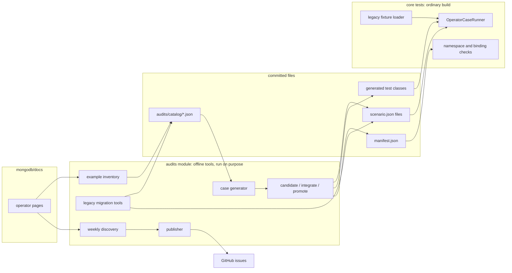
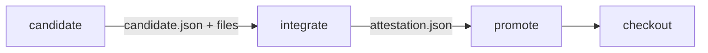
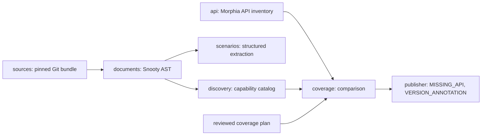

# Operator audits design

How the operator audits work as they are built today. This is the map of the system: what each
part does, how the parts connect, and the rules they all follow. Other documents cover the rest:

| Document | Covers |
| --- | --- |
| [audits/README.md](../audits/README.md) | Operating the audits: commands, the weekly report, troubleshooting. |
| [operator-audits-reference.md](operator-audits-reference.md) | Each component's contract in detail: inputs, outputs, exit codes, limits. |
| [mongodb-operator-audits.md](mongodb-operator-audits.md) | The migration plan: why the old audit was replaced, the target design, and the steps. |
| [operator-audits-progress.md](operator-audits-progress.md) | The progress log: what each PR delivered, and the work that remains. |

This document describes the code on its branch, not the plan. A change to how the audits work
updates this document in the same pull request. When the migration finishes, it remains the
description of the finished system.

## What the audits answer

Morphia builds MongoDB aggregation stages and expressions, query filters, and update operators
through a typed Java API. The MongoDB manual documents each operator with runnable examples. The
audits answer three questions, and keep answering them as the manual changes:

1. **Does each documented example have a test?** Every example on the current operator pages has
   exactly one owner: a handwritten test, a converted legacy test, or a generated test.
2. **Does Morphia do exactly what the example documents?** A test builds the example with
   Morphia's API and checks that the BSON Morphia sends matches the documented command, that it
   behaves like the documented command on a real server, and that the results match the page.
3. **What changed upstream?** A weekly job finds new examples and operators Morphia cannot express,
   and files them as issues.

The audits module also has a capability-coverage path (which operators, contexts and versions the
manual declares, compared with Morphia's API). It is built and tested, but it has no accepted
production baseline yet, so nothing runs it on a schedule. See [Capability coverage](#capability-coverage).

## Rules every part follows

- **Explicit inputs, candidate outputs.** Every command takes its inputs as arguments and writes
  a candidate. Nothing reads ambient state, such as the working directory or a previous run's
  output. Accepted files change only through a separate, deliberate step: a promotion, an
  `apply`, or a reviewed commit.
- **Ordinary builds stay offline.** A normal Maven build never fetches documentation, never runs
  the audits module, and never needs it. Core's tests read only committed files. The audits module
  joins the build only with `-Daudits`.
- **Strict comparison by default.** BSON types, numeric representation, key order and array order
  all count. Any leniency is declared per case with its reason: a form rule, an ignored field, an
  unordered result, or an unordered array.
- **Never loosen a case to make it pass.** When a documented example fails, it is either a Morphia
  bug to fix or an exclusion recorded with evidence (the page is wrong, or the server cannot run
  it). The generator never emits a weaker case.
- **Every disposition has evidence.** Exclusions, legacy-only cases, form rules and
  reviewed names are all committed with the reason and the source they rest on, so the counts can
  always be explained.
- **Deterministic output.** Outputs are sorted by stable identity and serialized the same way
  every time. A second run with the same inputs reproduces the committed files byte for byte, and
  offline tests check that.
- **Both mappers.** Every runnable case runs under Critter first, then reflection.

## The two halves

The system is split across two modules, connected only by committed files.

- **The audits module** (`audits/`) holds the tools: it reads pages, inventories examples, generates
  and converts cases, and files issues. It depends on core's sources and builds, but core never
  depends on it.
- **Core's operator tests** (`core/src/test/`) run the cases. They read scenarios, the
  manifest and the binding descriptor from the test classpath, and know nothing about pages or
  catalogs.

## Core: running a case

### The scenario

A case is one documented example, described entirely by a `scenario.json` (schema version 1):

| Field | Holds |
| --- | --- |
| `name`, `title`, `context` | The qualified name (`aggregation/expressions/add/addNonIntegerValuesToADate`), the page's title for it, and the operator context. |
| `source` | The repository, commit, path and blob of the page it came from. |
| `collections`, `indexes`, `dataset` | The seed data, in extended JSON with exact BSON types; the indexes the page creates, each with its collection, keys and options; or the sample dataset the example queries instead. |
| `action` | The documented command: an aggregate pipeline, a find (with the page's projection, if any), or an update, with its collection. |
| `expected` | The documented results, either exact BSON or `printed`: the constraints mongosh's printed output proves (see below). |
| `comparison` | Result order, declared form rules, ignored fields, unordered arrays and tolerance. |
| `requirements` | The minimum server version and topology. |
| `skipped` | Checks that do not run, each with its reason: `serialization`, `results` (behavior and published), or only `published`, for a reviewed page error. |

The name, not the test method's name, decides where the scenario lives. The runner never finds
fixtures by method name, ordinal or stack trace.

### The runner

`OperatorCaseRunner` takes a scenario and a function that builds the operation with Morphia's
API: `aggregate`, `find` or `update`. It seeds two identical databases with the documented data and
indexes, then checks three things separately, against a real server:

1. **Serialization.** The BSON Morphia emits equals the documented action, strictly, after the
   scenario's declared form rules are applied to both sides.
2. **Behavior.** The documented action, sent through the driver, and the Morphia operation run
   against two identically seeded databases and leave the same results and collections.
3. **Published expectation.** Both results equal the documented results, or satisfy what the
   printed results prove.

Three kinds of leniency exist, and each is declared per case rather than a loose comparison:

- **Form rules** (`FormRules`) map spellings the server treats identically to one canonical
  spelling, such as `{$eq: x}` and `x`, or the array and document forms of `$cond`. A rule applies
  to both sides and needs a reason recorded in the form review.
- **Printed results** (`PrintedResults`) cover output the page shows the way mongosh prints it. A
  printed `4` may be an Int32 or a Double, so it is a constraint, not a value.
- **Unordered arrays** (`comparison.unorderedArrays`) name result arrays, by pointer within each
  result, that the server builds in no defined order, such as the array `$graphLookup` writes.
  They must hold the same items, as often, in any order; every other array stays ordered. Each
  is declared in the form review with its evidence.

These are Java ports of audits-module code (`FormEquivalence`, `PublishedComparison` and
`BsonComparison`, whose strict checks `StrictBson` ports). Golden vectors under
`generated/vectors/` hold the two implementations to the same verdicts.

### Where cases live

| Kind | Test | Scenario |
| --- | --- | --- |
| **Generated** | A class in `dev.morphia.test.generated.<family>`, written by the generator. | `generated/fixtures/<family>/<operator>/<stem>/scenario.json` |
| **Migrated** | A handwritten body moved into the generated namespace, as a protected file. | Same as generated. |
| **Converted** | The unchanged legacy test method; `TemplatedTestBase` sees the scenario and routes the call through the runner. | The legacy fixture directory, which now holds only `scenario.json`. |
| **Legacy** | A legacy test reading `data.json`, `action.json` and `expected.json` through `TemplatedTestBase`. | None yet. |

`generated/manifest.json` lists every case on the runner (name, kind, scenario, test) and every
file the generated namespace owns, with its SHA-256. A `GENERATED` file is rewritten by generation;
a `PROTECTED` one never is. `GeneratedCasesTest` checks the namespace against the manifest in both
directions, so an unlisted, missing or edited file fails the build.

Legacy and converted tests are bound to their fixtures by `example-bindings.json`, which the
audits module captures from the test sources. `TestCoverageExtension` fails a test class whose
methods or fixture directories disagree with it.

## The audits module

### Packages

| Package | Role | In production use |
| --- | --- | --- |
| `generate` | Example inventory, DSL bindings, case generator, candidates. | Yes |
| `repairs` | Legacy migration: lock inventory, form rules, conversion, the migration ledger, the manifest. | Yes |
| `publish` | `gh` transport, the idempotent publisher, discovery findings. | Yes |
| `shell` | Lowers mongosh source into typed commands and BSON through a pinned Rhino AST, without evaluating it. | Yes, through `repairs` |
| `semantics`, `published` | Strict BSON comparison, and comparison against printed results. | Yes, through `repairs` |
| `api` | Inventories Morphia's public API with the JDK compiler, used to verify bindings. | Yes |
| `bindings` | Captures which legacy test owns which fixture, and the descriptive-name backport. | Yes |
| `naming` | Descriptive example names, and the name registry reconciler. | Names: yes. Reconciler: not yet. |
| `rst`, `model` | The legacy line-based RST extractor. | Yes, until the structured parser replaces it |
| `sources`, `documents`, `discovery`, `scenarios` | Pinned Git source bundles, the Snooty parser adapter, capability discovery, structured scenario extraction. | Not yet |
| `coverage` | Capability catalog and plan contracts, coverage comparison, and `AuditJson`, the strict JSON codec every package uses. | `AuditJson`: yes. Comparison: not yet. |

Each package with a command has a `*Main.kt` entry point, run through the exec plugin with
`-Daudits.mainClass`. The README lists the commands; the reference gives each one's contract.

### Committed catalog

`audits/catalog/` holds the reviewed inputs and the accepted outputs. The README's table lists
every file. The ones the running system depends on:

| File | Written by | Read by |
| --- | --- | --- |
| `documented-examples.json` | `GenerateMainKt inventory` | The generator, discovery's diff, the publisher's new-example check. |
| `dsl-bindings.json` | Hand, reviewed | The generator, after verification against core's API. |
| `generation-review.json` | Hand, reviewed | The generator: which families to generate, and the exclusions. |
| `fixture-migration.json` | `FormMainKt migrate` / `convert` | The manifest, candidates, `rescenario`. |
| `cutover.json` | Hand, from failed conversions | The conversion completeness check. |
| `form-review.json`, `form-migration.json` | Review, then `FormMainKt capture` | Conversion, which carries the rules into each scenario. |
| `publication-policy.json` | Hand | The publisher: the labels for each finding type. |

### Example inventory

Every example on the current operator pages, with its owner, lives in `documented-examples.json`.

1. `fetch.py local` collects the operator pages and their includes at one mongodb/docs commit
   from a sparse Git clone. `fetch.py current` followed by `fetch.py pages` does the same through
   the GitHub API, which rate-limits.
2. `GenerateMainKt inventory` extracts each page's examples and matches each one to an existing
   fixture: by title, or, if the title changed, by its action text, or else by its descriptive name
   (the backport named every fixture for its example). The matching uses the legacy RST
   extractor, which is also how the fixtures were made.

Each example gets one status:

- **OWNED**: a handwritten, migrated or converted case covers it.
- **UNOWNED**: nothing covers it; the inventory keeps its source blocks so generation never needs
  the page again.
- **UNNAMED**: it has no usable title, so it needs a reviewed name.
- **AMBIGUOUS**: its name collides with another, or several fixtures match it.

`example-names.json` holds the reviews that resolve the last two: a descriptive name for a generic
title, or the owner among several matching fixtures, each with its reason. A review is keyed by page,
title and the action block's SHA-256, so an example that changes upstream comes back for review; the
inventory counts the reviews that no longer apply (`reviews.stale`). A reviewed name is the
generated case's title and display name.

Generated cases never count as owners: generation derives them from the unowned examples on
every run.

Before extraction, a page is reduced to its mongosh content. Of a `.. tabs-drivers::` set only
the `shell` tab is kept, and of a composable tutorial only the `.. selected-content::` selected for
`shell`; the other drivers' content holds their own code and remote shared includes. The files that
`.. input::`, `.. output::` and `.. literalinclude::` name are then spliced in as inline blocks:
MongoDB's tested snippets (`/code-examples/tested/...`, read from `content/code-examples`) and
include files. Each is recorded with its blob, like an include. Many tested snippets query MongoDB's
sample datasets (`db.movies`) and print elided results; they extract like any other example and
then show up as generation gaps.

### Generation

`GenerateMainKt candidate` turns each unowned example of the reviewed families into a scenario and
a test method:

1. **Verify the bindings.** Each entry in `dsl-bindings.json` maps an MQL operator, as a stage, an
   expression or a query filter, to a Morphia factory by its exact erased signature, with the form
   its BSON takes:
   - `POSITIONAL` and `NAMED` for operators, `PROJECTION`, `FIELDS`, `GROUP` and `SORT` for those
     stages, `FILTERS` for `$match`, and `FIELD` for a query or update operator on a field;
   - the `[]` entry binds an array literal (`ArrayExpressions.array`).

   The API inventory of core's current source must contain every one; a stale binding stops
   generation.
2. **Lower the source.** `FormMigration.documented` turns the example's mongosh blocks into typed
   seed data, an action and expected results, through `ShellPrograms`.
3. **Emit the call.** The emitter walks the action: a pipeline becomes `runner.aggregate`, a find
   `runner.find` with the filter's `Filters` calls, and an update `runner.update` with the filter and
   one `UpdateOperators` call per field. Every node needs a binding, and every value is emitted only
   in a form its parameter type accepts: a sort document as `Sort` varargs, and an array as `List.of`
   where it is data (a query or update operand, an `Iterable`) or as `array(...)` where it is an
   expression. The first node without a binding makes the example a gap; so does a documented
   projection or a pipeline update.
4. **Write the scenario.** `FixtureMigration.scenario` writes it in the same format a converted
   case uses, ordered. Its form rules are those the emitted spelling needs: `EQ_SHORTHAND` when a
   plain value became `eq()`, `FIELD_OPERATORS_AND` when one field's operators became one filter
   each, and `NAMED_ARGUMENTS` when it calls an operator that takes only named arguments, whose
   order the server ignores and Morphia chooses.

An example that seeds no data and queries a collection of MongoDB's sample datasets, as most tested
snippets do, names that dataset (`generation-review.json`'s `sampleDatasets`). The tests do not load
sample datasets, so its scenario skips the results checks with that reason, and only its
serialization is checked: Morphia must still build exactly the documented pipeline.

Examples that are not generated are listed in `gaps.json`, each with its reason:

| Gap | Means | Fix |
| --- | --- | --- |
| `UNBOUND` | A node has no binding: `stage $match has no binding`. | Add the binding. |
| `SOURCE_UNSUPPORTED` | The mongosh text does not lower, or the action is not a pipeline. | Parser or generator work. |
| `UNNAMED`, `AMBIGUOUS` | The example has no unique name. | Review a name. |
| `EXCLUDED` | A reviewed exclusion. | Its reason says what would lift it. |
| `PROTECTED_CLASS` | The operator's class holds a moved handwritten body. | Move the body or the case. |

All four families are generated today: aggregation expressions and stages, query filters and
updates. Most remaining gaps are bindings, database-level commands (`db.aggregate(...)`),
documented projections and update options (`arrayFilters`).

### Candidates, integration and promotion

Generation never writes into the checkout. It goes through three steps, each refusing anything
it cannot verify:

- **candidate** regenerates the whole namespace (every ledger scenario, every generated case and
  the manifest) into a new directory. `candidate.json` records the base revision, the manifest's
  digest, and the hash of every file to write, delete or protect.
- **integrate** applies the candidate in a temporary worktree at its base, builds core, and runs
  the owning tests under Critter, then reflection. It writes `attestation.json`, bound to the
  candidate's hash, and `integration.log`.
- **promote** applies an attested candidate only to a checkout still at the same base, with the
  same manifest and every protected file unchanged. It never overwrites a file the manifest does not
  own, and it restores every original if any write fails.

Regenerating a promoted tree produces no changes.

### Legacy migration

Core started with 555 legacy fixture directories, many guarded by `lock` files that stopped the
old audit from overwriting curated changes. The migration tools move them onto the runner without
losing what the locks protected:

1. **Preserve.** `legacy-corpus.json` snapshots the original corpus; `legacy-bindings.json` and
   `example-bindings.json` record which test owns which fixture.
2. **Name.** The name backport replaced ordinal `exampleN` names with descriptive ones from the page
   titles (`name-backport.json`).
3. **Classify the locks.** `curated-repairs.json` categorizes every lock and exclusion, guided by
   `repair-review.json`.
4. **Explain the differences.** For each locked fixture, the form review finds the historical page
   it came from and the declared rules, numeric retypes or corrections that reproduce it exactly
   (`form-review.json`, captured as `form-migration.json`). Never-locked fixtures are pinned to their
   pages in `legacy-references.json`.
5. **Convert.** `FormMainKt convert` replaces a fixture's files with a scenario built from its
   documented source, and records the move in `fixture-migration.json`. A case that converts but
   fails a strict check is reverted and recorded in `cutover.json` as legacy-only, with the failing
   check. When a legacy test body or fixture file had to change first, the ledger records the
   change as a reviewed edit with the digest it started from, so the preserved originals still
   check.

6. **Delete the unbacked.** A legacy test whose fixture no documented source reproduces was
   deleted with its fixture, and `deleted-fixtures.json` records the test's body digest, the
   fixture files' digests and the reason. The preservation checks hold those records to the
   corpus snapshot and the frozen binding catalog, as they do the migration ledger. With the
   legacy owner gone, the example's documented form is generated when its bindings allow.

The cases that stay on the legacy loader all have a documented source and fail a strict check;
the progress file tracks them.

### Weekly discovery

`.github/workflows/operator-discovery.yml` runs every Monday and on demand.

**Discover job** (read-only token):

1. It clones mongodb/docs sparsely and without blobs, limited to the operator pages and includes,
   which avoids the API rate limit.
2. `audits/discover.sh` runs in a throwaway worktree of HEAD:
   - it reinventories the pages, and `inventory.diff` shows the changes against the committed
     inventory;
   - it generates a candidate with the committed bindings and review, which writes `gaps.json`;
   - it integrates the candidate under both mappers.
3. The job writes `summary.md` to the job summary and uploads every report.

**Publish job** (may write issues, not contents):

1. `PublishMainKt discovery` turns the reports into findings with `DiscoveryFindings`:
   - `MISSING_BINDING`: one per unbound node, listing every example it blocks;
   - `NEW_EXAMPLE`: an unowned example that is not in the committed inventory;
   - `INTEGRATION_FAILURE`: the failing tests from the log.
2. The publisher files them in MorphiaOrg/morphia.

Neither job commits or promotes anything. Accepting a changed inventory is a local, reviewed change
made with the same commands.

### Publishing

`Publisher` files findings as issues and is safe to rerun:

- Each issue carries its finding's stable key in a hidden marker, so a recurring finding updates
  its issue instead of creating another.
- The publisher owns only the text between its markers. It adds labels without removing any, sets
  a milestone only when none is set, and never reopens or edits a closed issue.
- Before each create it writes its intent to a journal, so a lost response is reconciled, not
  duplicated. The journal is carried between scheduled runs, because GitHub's issue listing can lag
  a recent create.
- Labels come from `publication-policy.json`. A label that does not exist stops publication.
- Issues join the milestone of the release the root `pom.xml` is building: `3.0.1-SNAPSHOT` gives
  `3.0.1`. When that milestone does not exist and there is something to publish, the publisher
  creates it first. A closed one stops publication, because that version has already shipped.

`GhGateway` is the only route to GitHub. It runs `gh` with an explicit repository and a cleaned
environment. A report-only gateway cannot spawn a mutating command, and a publishing gateway can
only create or edit issues and create milestones. Trial runs go to a disposable sandbox repository,
never MorphiaOrg/morphia.

### Capability coverage

The structured path is built, but not yet in production use. It goes from pinned sources to a
coverage report:

- **sources** captures exact Git objects into a verified bundle.
- **documents** runs MongoDB's own Snooty parser, at a pinned commit and lockfile, in an isolated
  Python runtime with network and file access confined.
- **discovery** normalizes the AST into a capability catalog: operators by context, facets, version
  lifecycle events, and the evidence for each.
- **coverage** compares the catalog with a reviewed plan and the API inventory. It reports missing
  APIs and wrong version annotations, and never treats a partial result as proof that something
  is absent.

Two pieces are missing before this path replaces the legacy extractor and runs on a schedule: an
accepted production baseline for the plan, and snippet resolution in the structured scenario
extraction (the legacy extractor splices snippets in itself). Until then, example extraction uses
the legacy RST extractor described above.

## Testing the audits

- **Offline tests** (`./mvnw -Daudits -pl audits verify`) need no MongoDB, docs checkout, `gh` or
  token. They use small synthetic fixtures. They also recheck the committed catalogs against fresh
  captures from the tree, so a stale binding catalog, repair inventory, manifest, ledger or
  form report fails.
- **Parser tests** run the pinned Snooty adapter's regressions and the Kotlin coordinator
  integration. They skip unless the isolated parser runtime is supplied.
- **Sandbox tests** (`-Daudits.sandbox=OWNER/REPO`) run the gateway and publisher against a real,
  disposable repository.
- **Core's tests** run every case on the runner, plus `GeneratedCasesTest`,
  `ExampleBindingsTest`, the golden-vector tests and the runner's self-tests, under both mappers.

`.github/workflows/audits.yml` runs the offline and parser tests on pull requests that touch the
audits module or core's operator tests.

## Transitional parts

These exist only until the migration finishes. The plan says what retires each one.

- **The legacy fixture loader** in `TemplatedTestBase`, for fixtures not yet on the runner.
- **The legacy RST extractor** (`rst/`, `model/`), which the example inventory and conversion use.
- **`FormMainKt` conversion commands and their review files**, needed while legacy fixtures remain.

## Keeping this document current

Update this document in the same pull request as any change to:

- what a component does, or how the components connect;
- the scenario, manifest or catalog formats;
- the workflows;
- the rules above.

Move a component from "Not yet" to "Yes" in the package table when it enters production use, and
remove a transitional part when it retires. Command syntax and per-component limits belong in
the README and the reference; progress and remaining work belong in the progress file.
